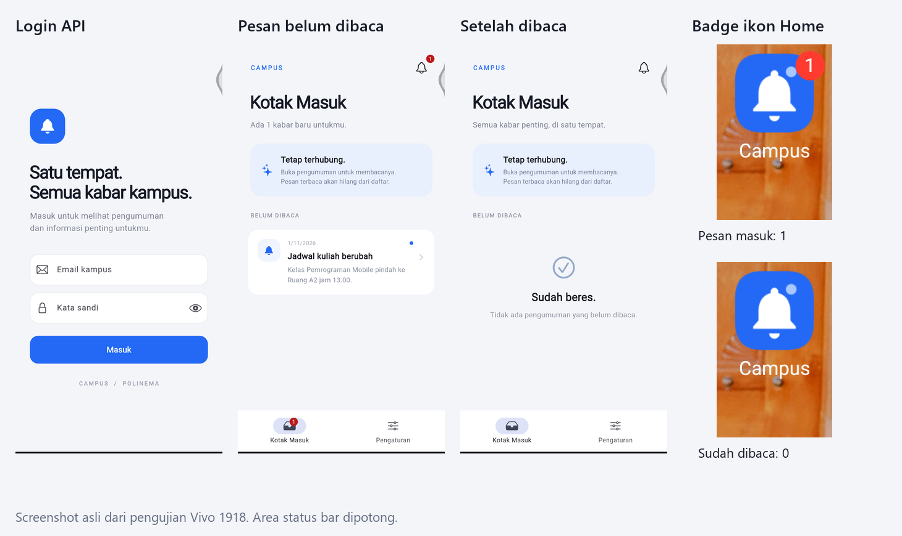
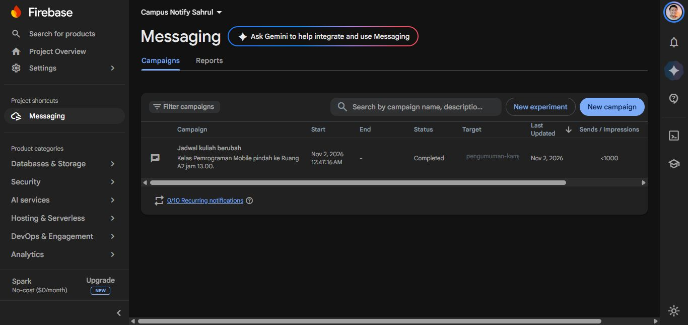

# Campus Notification App

Sahrul Ramadhani · 244107020058 · TI-3C

Praktikum Minggu 6: Authentication, Security, dan FCM.

Panduan langkah penggunaan mobile, pengiriman oleh admin, teknologi setiap fitur, dan skenario demo tersedia di [docs/panduan-penggunaan.md](docs/panduan-penggunaan.md).

## Tujuan

Membuat aplikasi pengumuman kampus dengan login API dan notifikasi yang membuka halaman tujuan.

## Fitur

- Login Laravel API, JWT access token, refresh token berotasi, dan logout.
- Email login menerima huruf besar/kecil. Akun lokal saat ini: rama@polinema.ac.id; kata sandi ada di login-lokal.txt.
- Token disimpan di flutter_secure_storage. Request Dio memakai Bearer token.
- Respons 401 memicu refresh dan retry maksimal sekali. Refresh tidak valid menghapus sesi.
- GoRouter melindungi halaman pengguna.
- FCM, notifikasi lokal saat foreground, dan topik pengumuman-kampus.
- Daftar belum dibaca disimpan di server. Membuka detail menandai pesan dibaca dan menghapusnya dari daftar.
- Badge lonceng, integrasi badge launcher, serta notifikasi bersuara.
- Tampilan sederhana dengan susunan dan ikon bergaya iOS.

## Struktur

Project Flutter campus_notify berada langsung di folder ini. Backend Laravel ada di backend/. Folder lib/, test/, docs/, dan screenshots/ mengikuti jobsheet.

## Stack teknologi

Flutter dan Dart, Riverpod, GoRouter, Dio, flutter_secure_storage, Firebase Core/Messaging, flutter_local_notifications, serta Laravel 13 dengan SQLite. SharedPreferences hanya menyimpan preferensi topik dan antrean pesan, bukan access/refresh token.

## Menjalankan

Kebutuhan: Flutter, PHP 8.5 yang tersedia di laptop, Composer, Python dengan cryptography, dan HP Android tersambung USB.

1. Jalankan `composer install` dari backend menggunakan PHP yang sesuai.
2. Jalankan `python scripts/setup_local.py` dari folder project Flutter.
3. Dari backend, jalankan `php artisan migrate` dan `php artisan db:seed --class=CampusSeeder`.
4. Simpan google-services.json project Firebase sendiri di android/app/. Package Android: id.ac.polinema.sahrul.campus_notify.
5. Terminal backend: `php artisan serve --host=127.0.0.1 --port=8006`.
6. Terminal project Flutter: `python scripts/https_proxy.py`.
7. Jalankan `adb reverse tcp:8446 tcp:8446`, kemudian `flutter run -d 33a40574`.
8. Kredensial lokal ada di login-lokal.txt. File ini tidak masuk Git.

Di laptop ini, cara cepat menjalankan kembali adalah `./run-vivo.ps1`. Gunakan PHP 8.5, karena perintah php bawaan PATH laptop masih mengarah ke PHP 8.1.

HTTPS lokal diverifikasi memakai sertifikat pengembangan yang dibuat di laptop. Kepercayaan sertifikat tambahan hanya aktif pada build debug untuk localhost. Release memakai sertifikat server yang dipercaya sistem. Tidak ada bypass pemeriksaan sertifikat.

Untuk server HTTPS lain: `flutter run --dart-define=API_BASE_URL=https://server-anda/api`.

## Mengirim pengumuman

Firebase Console > Messaging > Compose notification:

- Judul dan isi pengumuman.
- Topic: pengumuman-kampus.
- Android Notification Channel: pengumuman.
- Custom data: route=/pengumuman/3 dan id=3.
- Sound: Enabled.

Untuk pengumuman baru, buat data dahulu dengan perintah campus:announce di bawah, lalu gunakan ID yang dicetak sebagai id dan route di Firebase. ID 3 disediakan sebagai contoh jobsheet. Pesan untuk pengumuman yang sudah dibaca tidak membuat salinan berulang di daftar.

Gunakan gabungan notification dan data. Foreground memakai local notification. Background memakai banner Android dan onMessageOpenedApp. Terminated memakai getInitialMessage setelah router dan sesi siap.

Backend juga menyediakan `php artisan campus:announce "Judul" "Isi"` untuk menyimpan pengumuman. Tambahkan `--send` setelah mengisi FIREBASE_CREDENTIALS dengan path service account server. Gunakan `--personal=email@kampus.ac.id` untuk pesan pribadi. Kunci service account hanya berada di server, tidak di Flutter atau Git.

## Pengujian

- flutter analyze: tidak ada issue.
- flutter test: 14 test lulus, termasuk regresi logout dan antrean pesan yang ditolak API.
- php artisan test: 14 test lulus, 68 assertions, termasuk variasi email login dan notifikasi dengan isi kosong.
- Bukti uji perangkat dicatat di [docs/validasi.md](docs/validasi.md).

| Kondisi | Yang harus dibuktikan | Hasil perangkat |
|---|---|---|
| Foreground | Banner lokal bersuara, klik membuka detail 3 | Lulus di Vivo, screenshot 04 dan 05 |
| Background | Banner Android, klik membuka detail 3 | Lulus di Vivo, screenshot 07 dan 08 |
| Terminated | Klik menjalankan aplikasi ke detail 3 | Lulus setelah swipe-close, screenshot 10 dan 11 |

Swipe-close berbeda dengan Force stop Android. Force stop memang dapat menghentikan penerimaan push sampai aplikasi dibuka kembali.

Badge ikon Home mengikuti dukungan launcher. Indikator jumlah belum dibaca di dalam aplikasi tetap mengikuti data server. Suara mengikuti izin, channel, volume, dan mode senyap perangkat.

Pada Vivo 1918, aktifkan Pengaturan notifikasi Campus > Lambang ikon aplikasi layar beranda. Pengaturan ini sudah diaktifkan saat validasi. Badge merah 1 muncul saat pesan masuk dan hilang setelah pesan dibaca. Mode bunyi dan volume notifikasi 3/7 juga sudah diperiksa.

## Bukti utama

Screenshot tiap app state, token yang dipotong, dan pengujian terakhir tersedia di [catatan validasi](docs/validasi.md). APK akhir sudah dipasang di Vivo, login kembali, dan menerima pesan menggunakan token baru setelah hapus data.

## Refleksi

1. Refresh token tidak boleh di SharedPreferences karena tidak disediakan sebagai penyimpanan rahasia terenkripsi. Jika bocor, token dapat dipakai untuk meminta sesi baru. Aplikasi memakai secure storage dan server menyimpan hash refresh token.
2. Mengabaikan onTokenRefresh membuat backend menyimpan token lama. Pesan dapat gagal sampai perangkat didaftarkan ulang.
3. Topik cocok untuk perubahan jadwal satu kampus. Token perangkat cocok untuk informasi pribadi seperti tagihan. Pesan pribadi tidak dikirim ke topik umum.
4. Contoh AI diperbaiki dengan pembatas retry, satu proses refresh untuk request bersamaan, validasi rute, penyimpanan status baca di server, dan navigasi klik notifikasi lokal. Hasilnya diuji dengan fake repository dan perangkat.

## Acuan

[Jobsheet Minggu 6](https://jti-polinema.github.io/flutter-codelab/06-minggu-6-authentication-security-fcm/index.html#0)

Tambahan dosen: login dari API, daftar notifikasi hilang setelah dibaca, indikator ikon, dan suara.
