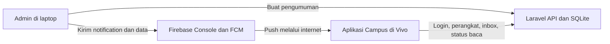

# Panduan penggunaan Campus Notify

Project Minggu 6: Authentication, Security, dan Firebase Cloud Messaging.

## 1. Bagian sistem dan tugasnya

Ada dua peran pengguna: admin mengirim pengumuman, mahasiswa menerima dan membacanya. Sistemnya terdiri dari tiga bagian:

| Bagian | Dipakai untuk | Teknologi |
|---|---|---|
| Admin di laptop | Membuat data pengumuman dan mengirim push | Perintah Laravel `campus:announce` dan Firebase Console > Messaging |
| Aplikasi Campus di Vivo | Login, menerima notifikasi, melihat inbox, membaca pengumuman, mengatur langganan | Flutter/Dart |
| API di laptop | Memeriksa login, menerbitkan token, menyimpan perangkat, pengumuman, dan status baca | Laravel 13 + SQLite |

Admin saat ini memakai Firebase Console di browser dan satu perintah untuk membuat data pengumuman. Belum ada dashboard admin web khusus. Firebase dipakai untuk pengiriman push; login mahasiswa diproses oleh API Laravel.



## 2. Menjalankan kembali di laptop ini

1. Sambungkan Vivo melalui USB. USB debugging harus aktif dan perangkat sudah mengizinkan laptop ini.
2. Pastikan Vivo dan laptop mempunyai akses internet. FCM memakai internet; USB dipakai untuk menghubungkan Vivo ke API lokal.
3. Buka PowerShell, lalu jalankan:

```powershell
Set-Location -LiteralPath 'D:\Pemrograman Mobile\Minggu-06'
.\run-vivo.ps1
```

Script akan menjalankan API Laravel pada port 8006, proxy HTTPS pada port 8446, meneruskan port melalui `adb reverse`, dan menjalankan Flutter pada Vivo serial `33a40574`. Build pertama setelah perubahan dapat memerlukan beberapa menit.

API yang dipakai aplikasi adalah `https://127.0.0.1:8446/api`. Dalam konfigurasi ini alamat tersebut diteruskan ke laptop melalui USB. Jika kabel dilepas atau laptop mati, login, pemuatan detail, dan pembaruan status baca tidak bisa mengakses API. Push FCM tetap memakai jalur internetnya sendiri; banner dapat masuk walaupun API sedang tidak tersedia.

Jika aplikasinya sudah terpasang dan hanya ingin menyiapkan layanan lokal, menjalankan script yang sama merupakan cara paling mudah. Menekan `q` pada terminal Flutter menghentikan sesi Flutter; proses API/proxy yang dimulai script berjalan terpisah.

## 3. Menggunakan aplikasi di Vivo

1. Buka aplikasi bernama **Campus** dengan ikon lonceng biru.
2. Masuk memakai email `rama@polinema.ac.id` (huruf besar/kecil bebas). Kata sandi lokal tersedia di [login-lokal.txt](../login-lokal.txt).
3. Pada **Kotak Masuk**, lihat daftar pengumuman yang belum dibaca. Tarik daftar ke bawah untuk menyegarkan data.
4. Ketika push masuk, banner tampil dan indikator jumlah diperbarui. Ketuk banner atau salah satu kartu pengumuman.
5. Setelah detail berhasil dimuat dan status baca disimpan ke API, halaman menampilkan **Sudah dibaca**.
6. Kembali ke Kotak Masuk. Pengumuman tersebut hilang dari daftar belum dibaca dan jumlah badge berkurang. Data pengumumannya tetap berada di database dengan `read_at` terisi.
7. Buka **Pengaturan** untuk mengubah switch **Pengumuman kampus**. ON berlangganan topik `pengumuman-kampus`, OFF berhenti menerima broadcast topik itu. Switch ini mengatur push topik; data inbox yang sudah dibuat di server tetap ada.
8. Tekan **Keluar akun** untuk mencabut sesi di API, melepas registrasi perangkat aktif, berhenti dari topik, membersihkan notifikasi, dan kembali ke login. Untuk uji logout, pertahankan koneksi API dan internet.

Login tersimpan secara aman sehingga biasanya tidak perlu diulang setiap membuka aplikasi. Access token yang kedaluwarsa diperbarui otomatis. Jika refresh token sudah tidak berlaku, aplikasi meminta login kembali.

## 4. Admin: membuat dan mengirim pengumuman baru

### A. Buat data pengumuman

Buka terminal PowerShell kedua. Gunakan PHP 8.5 yang tersedia di laptop, karena `php` bawaan PATH masih mengarah ke PHP 8.1.

```powershell
Set-Location -LiteralPath 'D:\Pemrograman Mobile\Minggu-06\backend'
& 'C:\laragon\bin\php\php-8.5.5-Win32-vs17-x64\php.exe' artisan campus:announce 'Info praktikum Mobile' 'Praktikum dimulai pukul 13.00 di Ruang A2.' --no-interaction
```

Perintah menyimpan pengumuman dan membuat inbox bagi pengguna yang terdaftar. Terminal akan mencetak ID dan rute, misalnya `ID: 7 | route: /pengumuman/7`. Angka 7 hanya contoh: gunakan ID yang benar-benar keluar dari terminal.

Perintah ini menyimpan data. Pengiriman push dilakukan pada langkah B. Karena data sudah dibuat di server, menarik inbox dapat menampilkan pengumuman sebelum push dikirim.

### B. Kirim push dari Firebase Console

1. Buka [Messaging project Campus Notify Sahrul](https://console.firebase.google.com/u/0/project/campus-notify-sahrul/messaging).
2. Pilih **New campaign**, lalu jenis notifikasi Firebase bila pilihan jenis campaign muncul.
3. Isi **Notification title** dan **Notification text** dengan judul dan isi yang sama seperti pengumuman di API.
4. Pada **Target**, pilih topik `pengumuman-kampus`.
5. Pada **Scheduling**, pilih kirim sekarang.
6. Pada **Additional options**, isi tabel berikut menggunakan ID dari langkah A:

| Kolom | Nilai contoh jika ID yang dibuat adalah 7 |
|---|---|
| Android Notification Channel | `pengumuman` |
| Custom data key `route` | `/pengumuman/7` |
| Custom data key `id` | `7` |
| Sound | `Enabled` |

7. Pilih **Review**, periksa target dan isi, lalu pilih tombol publikasi/pengiriman yang ditampilkan Firebase.
8. Tunggu push di Vivo. Aplikasi harus sudah login dan switch **Pengumuman kampus** ON.

Judul dan isi membentuk bagian `notification`; pasangan `route` dan `id` membentuk bagian `data`. Keduanya diperlukan agar banner mempunyai teks dan kliknya membuka detail yang benar.

Gunakan pengumuman baru untuk setiap putaran demo inbox. Mengirim ulang ID yang sudah dibaca tidak mengubahnya menjadi belum dibaca, karena aplikasi mempertahankan status baca dan mencegah duplikasi.

Firebase Console juga menyediakan **Send test message** untuk menguji satu token perangkat. Halaman aplikasi hanya memperlihatkan token terpotong. Setelah hapus data, reinstall, atau rotasi, gunakan token terbaru; token lama dapat berhenti menerima pesan. Uji broadcast topik di atas tidak memerlukan penyalinan token secara manual.

### C. Pilihan pengiriman langsung melalui backend

Backend sudah mempunyai pengirim FCM HTTP v1, tetapi service account server belum dikonfigurasi. Cara yang telah diuji adalah Firebase Console pada langkah B. Setelah kredensial server dikonfigurasi, opsi `--send` dapat menyimpan dan mengirim dalam satu perintah:

```powershell
& 'C:\laragon\bin\php\php-8.5.5-Win32-vs17-x64\php.exe' artisan campus:announce 'Judul' 'Isi pengumuman' --send --no-interaction
```

Untuk pengumuman pribadi, backend mendukung `--personal=email@kampus.ac.id`; bila memakai `--send`, targetnya token perangkat pengguna tersebut. Broadcast memakai topik. Kredensial service account berada di server dan tidak dimasukkan ke aplikasi Flutter.

## 5. Fitur dan teknologi yang dipakai

| Fitur | Teknologi | Cara kerjanya di project ini |
|---|---|---|
| Aplikasi mobile dan UI bergaya iOS | Flutter, Dart, Cupertino Icons, tema iOS | Halaman login, inbox, detail, pengaturan, kartu putih, aksen biru, dan sudut membulat |
| State login dan inbox | `flutter_riverpod` | Provider menyimpan status async dan memperbarui UI ketika login atau inbox berubah |
| Navigasi dan guard login | `go_router`, `lib/routes.dart` | Pengguna tanpa sesi diarahkan ke login; payload valid membuka `/pengumuman/:id` |
| Login API | Laravel 13, SQLite, `firebase/php-jwt` | API memeriksa email dan hash kata sandi, lalu menerbitkan access token JWT HS256 dan refresh token |
| Request dan refresh otomatis | `dio` | Menambahkan header Bearer; 401 memicu refresh dan retry maksimal sekali; request bersamaan berbagi proses refresh |
| Penyimpanan token | `flutter_secure_storage` | Menyimpan access token, refresh token, identitas sesi, dan token perangkat menggunakan penyimpanan aman platform |
| Masa berlaku sesi | JWT + tabel `auth_sessions` | Access token 15 menit; refresh token 7 hari dan berotasi; server menyimpan hash refresh token |
| Pengiriman push | Firebase Cloud Messaging melalui `firebase_core` dan `firebase_messaging` | Firebase mengirim notification + data ke topik atau token perangkat |
| Pendaftaran token perangkat | `getToken`, `onTokenRefresh`, Laravel `POST /devices`, `uuid` | Backend memperbarui token per instalasi; perubahan token menaikkan penghitung versi |
| Banner saat aplikasi terbuka | `flutter_local_notifications` | `onMessage` menampilkan notifikasi lokal secara manual |
| Klik notifikasi saat background | `firebase_messaging` + GoRouter | `onMessageOpenedApp` membawa payload ke rute detail |
| Klik notifikasi saat terminated | `getInitialMessage` + GoRouter | Pesan awal diproses setelah sesi dan router siap |
| Handler background | Fungsi top-level dengan `@pragma('vm:entry-point')` | Menyimpan antrean ringan tanpa mengakses BuildContext atau UI |
| Inbox dan status dibaca | Laravel API + tabel SQLite `announcements` dan `inbox` | GET inbox mengambil yang `read_at` masih kosong; membuka detail menandainya dibaca |
| Pencegahan pesan ganda | ID pengumuman, message ID, dan constraint database | Pesan berulang tidak membuat salinan inbox atau menghapus status baca |
| Badge di dalam aplikasi | Widget `Badge` Flutter + jumlah inbox | Indikator lonceng dan tab mengikuti jumlah belum dibaca |
| Badge ikon Home | `app_badge_plus` dan plugin lokal `legacy_vivo_badge` | Plugin lokal menambahkan dukungan launcher Vivo lama `com.bbk.launcher2` |
| Suara dan prioritas | Channel Android `pengumuman`, `Importance.high`, `playSound`, pengaturan perangkat | Foreground memakai local notification; background memakai banner sistem dengan Sound Enabled |
| Diagnosis suara | Android `AudioManager` melalui plugin lokal | Menampilkan mode bunyi dan volume notifikasi di Detail pengujian |
| Preferensi dan antrean lokal | `shared_preferences` | Menyimpan pilihan topik, antrean pesan, dan cache ID baca; access/refresh token berada di secure storage |
| HTTPS pengembangan | Python `ssl`, sertifikat pengembangan, Dio | Flutter memverifikasi sertifikat lokal pada build debug; proxy meneruskan ke Laravel melalui loopback laptop |
| Penghubung HP ke API laptop | Android Debug Bridge `adb reverse` | Port HTTPS Vivo diteruskan melalui USB ke laptop |
| Tes | `flutter_test`, PHPUnit, Laravel Pint | Tes parsing rute, login, refresh, logout, inbox, dan endpoint; formatter menjaga gaya PHP |

Firebase Authentication dan Firestore tidak digunakan dalam alur ini. Autentikasi serta penyimpanan inbox ditangani Laravel dan SQLite. Tampilan bergaya iOS berjalan di Android; pengujian perangkat yang sudah dilakukan adalah Vivo 1918. Penggunaan push pada iPhone masih memerlukan konfigurasi Firebase iOS/APNs dan pengujian perangkat iOS.

## 6. Skenario demo kepada dosen

Untuk setiap baris berikut, buat ID pengumuman baru dan kirim dengan payload sesuai langkah admin.

| Skenario | Tindakan pada Vivo | Hasil yang diperiksa |
|---|---|---|
| Login API | Logout, lalu login memakai akun lokal | Sesi dibuat oleh API dan inbox dapat dimuat |
| Foreground | Biarkan Campus terbuka ketika push dikirim | Banner lokal masuk, indikator bertambah, klik membuka detail |
| Background | Tekan Home, lalu kirim | Banner Android masuk; klik membuka detail yang sesuai |
| Terminated | Swipe-close Campus dari recent apps, lalu kirim | Klik banner menjalankan aplikasi dan membuka detail |
| Status baca | Baca detail lalu kembali ke inbox dan buka ulang aplikasi | Pesan hilang dari daftar dan tetap terbaca karena tersimpan di server |
| Badge Home | Lihat ikon saat pesan belum dibaca, lalu baca pesannya | Badge merah bertambah, lalu berkurang/hilang |
| Suara | Dekatkan Vivo, gunakan mode bunyi dan volume notifikasi di atas nol, lalu kirim | Dengarkan apakah bunyi notifikasi terdengar |
| Langganan topik | OFF/ON switch Pengumuman kampus | Langganan berubah; uji broadcast setelah switch ON |
| Token lifecycle | Buka Pengaturan > Detail pengujian > Uji rotasi token pada build debug | Token terpotong dan penghitung event/versi diperbarui di API |

Swipe-close untuk uji terminated berbeda dengan tombol **Paksa berhenti / Force stop** pada pengaturan Android. Setelah Force stop, Android dapat menahan push sampai aplikasi dibuka lagi.

Hitungan event `onTokenRefresh` di layar adalah hitungan proses aplikasi saat ini; setelah proses dimulai ulang dapat kembali nol. Versi token di API adalah data server. Hapus data aplikasi menghasilkan pendaftaran awal baru melalui `getToken`.

## 7. Jika hasilnya belum sesuai

| Gejala | Pemeriksaan |
|---|---|
| Login atau detail gagal | Pastikan script berjalan, kabel terhubung, dan `adb devices` menampilkan `33a40574` dengan status `device` |
| Port USB terputus setelah mencabut kabel | Sambungkan lagi lalu jalankan script; atau pulihkan dengan `adb -s 33a40574 reverse tcp:8446 tcp:8446` |
| PHP menolak dependensi | Pakai executable PHP 8.5 pada contoh di atas, karena PATH laptop masih PHP 8.1 |
| Inbox kosong setelah mengirim ulang pesan | Buat pengumuman dengan ID baru; ID yang sudah dibaca tetap dianggap terbaca |
| Inbox ada, banner belum masuk | Data API dan push dikirim pada langkah terpisah; pastikan pengiriman Firebase sudah dilakukan |
| Broadcast tidak diterima | Periksa internet, izin notifikasi, status login, dan switch topik ON; buka Campus kembali jika sebelumnya Force stop |
| Klik menuju detail yang salah | Samakan ID hasil perintah dengan custom data `id` dan `route` di Firebase |
| Badge Home tidak terlihat | Pengaturan notifikasi Campus pada Vivo > aktifkan **Lambang ikon aplikasi layar beranda** |
| Banner muncul tanpa bunyi | Periksa mode Diam/Getar, volume notifikasi, Jangan Ganggu, pengaturan channel Pengumuman Kampus, serta Sound Enabled di Firebase |
| Token uji lama tidak bekerja | Token dapat berubah setelah hapus data/rotasi; gunakan token terbaru atau kirim melalui topik |

## 8. Status validasi dan berkas pendukung

- `flutter analyze`: bersih.
- `flutter test`: 14 tes lulus, termasuk antrean pesan gagal yang tidak boleh menghalangi inbox.
- Backend: 14 tes lulus, 68 assertions, termasuk email login dengan variasi huruf besar/kecil, penolakan kata sandi salah, dan notifikasi dengan judul saja.
- Login, logout, inbox, badge, tiga app state, topik, rotasi token, serta penerimaan setelah hapus data telah diuji di Vivo.
- Suara: channel dan konfigurasi perangkat terverifikasi. Pada uji ulang 2 November 2026, pengguna mengonfirmasi suara dan popup Tes notifikasi Vivo berhasil masuk.

Rincian bukti ada di [validasi.md](validasi.md), kontrak endpoint di [api.md](api.md), dokumentasi AI di [ai-challenge.md](ai-challenge.md), dan screenshot asli di [folder screenshots](../screenshots/).
